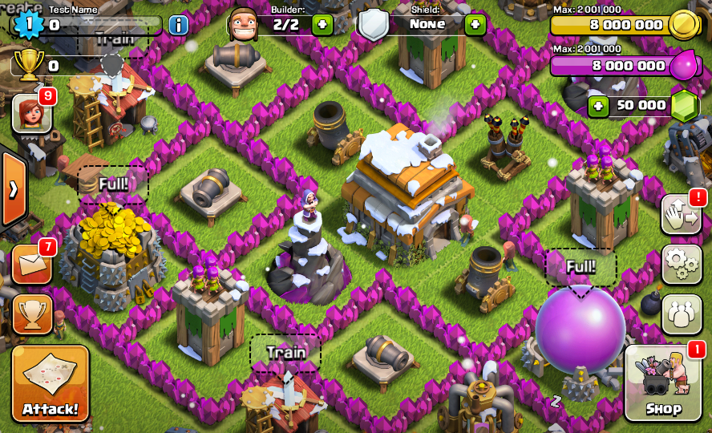

# coc-offline  

old clash of clans offline clients for android and ios, from v1.70 to v7.1.1. offline mode was available up to v7.1.1.

✅ = there's a build for that platform, ❌ = no build. blank changelog = i couldn't find a separate change for that exact version. some android and ios builds have different patch numbers for the same update.

## versions and downloads

all the files are also in the [`android/`](android/) and [`ios/`](ios/) folders, and together in the [release](https://github.com/8133/coc-offline/releases/tag/v1-v7.1.1). click apk or ipa to download that version.

| version | android | ios | release date | changelog | download |
| --- | :---: | :---: | --- | --- | --- |
| 1.70 | ❌ | ✅ | June 2012 beta | early beta build | [ipa](https://github.com/8133/coc-offline/releases/download/v1-v7.1.1/Clash_of_Clans_v1.70_offline.ipa) |
| 1.91 | ❌ | ✅ |  |  | [ipa](https://github.com/8133/coc-offline/releases/download/v1-v7.1.1/Clash_of_Clans_v1.91_offline.ipa) |
| 2.3 | ❌ | ✅ | August 4, 2012 | achievements, giant bomb, stronger walls | [ipa](https://github.com/8133/coc-offline/releases/download/v1-v7.1.1/Clash_of_Clans_v2.3_offline.ipa) |
| 2.21 | ❌ | ✅ | August 30, 2012 | hidden tesla, healer tweaks | [ipa](https://github.com/8133/coc-offline/releases/download/v1-v7.1.1/Clash_of_Clans_v2.21_offline.ipa) |
| 2.44 | ❌ | ✅ | September 19, 2012 | spells and defense replays | [ipa](https://github.com/8133/coc-offline/releases/download/v1-v7.1.1/Clash_of_Clans_v2.44_offline.ipa) |
| 2.73 | ❌ | ✅ | October 15, 2012 | chat moderation, clan trophy minimum | [ipa](https://github.com/8133/coc-offline/releases/download/v1-v7.1.1/Clash_of_Clans_v2.73_offline.ipa) |
| 2.86 | ❌ | ✅ | October 27, 2012 | halloween, town hall 9, x-bow and jump spell | [ipa](https://github.com/8133/coc-offline/releases/download/v1-v7.1.1/Clash_of_Clans_v2.86_offline.ipa) |
| 2.111 | ❌ | ✅ | November 19, 2012 | christmas: snow and santa spell/trap | [ipa](https://github.com/8133/coc-offline/releases/download/v1-v7.1.1/Clash_of_Clans_v2.111_offline.ipa) |
| 3.3 | ❌ | ✅ | January 10, 2013 | heroes and dark elixir | [ipa](https://github.com/8133/coc-offline/releases/download/v1-v7.1.1/Clash_of_Clans_v3.3_offline.ipa) |
| 3.25 | ❌ | ✅ | February 5, 2013 | level 6 troops and air traps | [ipa](https://github.com/8133/coc-offline/releases/download/v1-v7.1.1/Clash_of_Clans_v3.25_offline.ipa) |
| 3.54 | ❌ | ✅ | March 12, 2013 | dark barracks, minion, hog rider, valkyrie | [ipa](https://github.com/8133/coc-offline/releases/download/v1-v7.1.1/Clash_of_Clans_v3.54_offline.ipa) |
| 3.124 | ❌ | ✅ | April 17, 2013 | leagues and golem | [ipa](https://github.com/8133/coc-offline/releases/download/v1-v7.1.1/Clash_of_Clans_v3.124_offline.ipa) |
| 4.14 | ❌ | ✅ | May 23, 2013 | town hall 10 and inferno tower | [ipa](https://github.com/8133/coc-offline/releases/download/v1-v7.1.1/Clash_of_Clans_v4.14_offline.ipa) |
| 4.53 | ❌ | ✅ | June 17, 2013 | freeze spell and japanese language | [ipa](https://github.com/8133/coc-offline/releases/download/v1-v7.1.1/Clash_of_Clans_v4.53_offline.ipa) |
| 4.74 | ❌ | ✅ | July 29, 2013 | witch and clan replay sharing | [ipa](https://github.com/8133/coc-offline/releases/download/v1-v7.1.1/Clash_of_Clans_v4.74_offline.ipa) |
| 4.120 | ❌ | ✅ | August 27, 2013 | player profiles, hog rider rework | [ipa](https://github.com/8133/coc-offline/releases/download/v1-v7.1.1/Clash_of_Clans_v4.120_offline.ipa) |
| 5.2 | ❌ | ✅ | September 30, 2013 | village edit mode and halloween boosts | [ipa](https://github.com/8133/coc-offline/releases/download/v1-v7.1.1/Clash_of_Clans_v5.2_offline.ipa) |
| 5.2.2 | ❌ | ✅ | October 10, 2013 | village edit and ios 7 text fixes | [ipa](https://github.com/8133/coc-offline/releases/download/v1-v7.1.1/Clash_of_Clans_v5.2.2_offline.ipa) |
| 5.2.4 | ✅ | ❌ | October 2013 | android release of the village edit/halloween update | [apk](https://github.com/8133/coc-offline/releases/download/v1-v7.1.1/Clash_of_Clans_v5.2.4_offline.apk) |
| 5.2.7 | ✅ | ❌ | October 2013 |  | [apk](https://github.com/8133/coc-offline/releases/download/v1-v7.1.1/Clash_of_Clans_v5.2.7_offline.apk) |
| 5.2.11 | ✅ | ❌ | October 2013 |  | [apk](https://github.com/8133/coc-offline/releases/download/v1-v7.1.1/Clash_of_Clans_v5.2.11_offline.apk) |
| 5.64 | ✅ | ✅ | November 6, 2013 | upgrade and rearm traps, spells cost elixir | [apk](https://github.com/8133/coc-offline/releases/download/v1-v7.1.1/Clash_of_Clans_v5.64_offline.apk) · [ipa](https://github.com/8133/coc-offline/releases/download/v1-v7.1.1/Clash_of_Clans_v5.64_offline.ipa) |
| 5.113.2 | ✅ | ✅ | December 5, 2013 | christmas, multi-target inferno, loot changes | [apk](https://github.com/8133/coc-offline/releases/download/v1-v7.1.1/Clash_of_Clans_v5.113.2_offline.apk) · [ipa](https://github.com/8133/coc-offline/releases/download/v1-v7.1.1/Clash_of_Clans_v5.113.2_offline.ipa) |
| 5.172 | ✅ | ✅ | January 29, 2014 | hero abilities and clan co-leaders | [apk](https://github.com/8133/coc-offline/releases/download/v1-v7.1.1/Clash_of_Clans_v5.172_offline.apk) · [ipa](https://github.com/8133/coc-offline/releases/download/v1-v7.1.1/Clash_of_Clans_v5.172_offline.ipa) |
| 6.56.1 | ✅ | ✅ | April 9, 2014 | clan wars and war loot | [apk](https://github.com/8133/coc-offline/releases/download/v1-v7.1.1/Clash_of_Clans_v6.56.1_offline.apk) · [ipa](https://github.com/8133/coc-offline/releases/download/v1-v7.1.1/Clash_of_Clans_v6.56.1_offline.ipa) |
| 6.56.2 | ✅ | ❌ | April 2014 |  | [apk](https://github.com/8133/coc-offline/releases/download/v1-v7.1.1/Clash_of_Clans_v6.56.2_offline.apk) |
| 6.108.2 | ✅ | ✅ | May 16, 2014 | saved war base and war stats | [apk](https://github.com/8133/coc-offline/releases/download/v1-v7.1.1/Clash_of_Clans_v6.108.2_offline.apk) · [ipa](https://github.com/8133/coc-offline/releases/download/v1-v7.1.1/Clash_of_Clans_v6.108.2_offline.ipa) |
| 6.108.3 | ✅ | ✅ | May 2014 |  | [apk](https://github.com/8133/coc-offline/releases/download/v1-v7.1.1/Clash_of_Clans_v6.108.3_offline.apk) · [ipa](https://github.com/8133/coc-offline/releases/download/v1-v7.1.1/Clash_of_Clans_v6.108.3_offline.ipa) |
| 6.108.5 | ❌ | ✅ | June 2014 |  | [ipa](https://github.com/8133/coc-offline/releases/download/v1-v7.1.1/Clash_of_Clans_v6.108.5_offline.ipa) |
| 6.186.1 | ❌ | ✅ | July 3, 2014 | hero rebalance, jump spell rework | [ipa](https://github.com/8133/coc-offline/releases/download/v1-v7.1.1/Clash_of_Clans_v6.186.1_offline.ipa) |
| 6.186.3 | ✅ | ❌ | July 2014 |  | [apk](https://github.com/8133/coc-offline/releases/download/v1-v7.1.1/Clash_of_Clans_v6.186.3_offline.apk) |
| 6.253.4 | ❌ | ✅ | September 16, 2014 | lava hound and elixir wall upgrades | [ipa](https://github.com/8133/coc-offline/releases/download/v1-v7.1.1/Clash_of_Clans_v6.253.4_offline.ipa) |
| 6.253.5 | ✅ | ❌ | September 2014 |  | [apk](https://github.com/8133/coc-offline/releases/download/v1-v7.1.1/Clash_of_Clans_v6.253.5_offline.apk) |
| 6.322 | ✅ | ✅ | October 22, 2014 | halloween, skeleton trap | [apk](https://github.com/8133/coc-offline/releases/download/v1-v7.1.1/Clash_of_Clans_v6.322_offline.apk) · [ipa](https://github.com/8133/coc-offline/releases/download/v1-v7.1.1/Clash_of_Clans_v6.322_offline.ipa) |
| 6.322.3 | ✅ | ✅ | November 2014 |  | [apk](https://github.com/8133/coc-offline/releases/download/v1-v7.1.1/Clash_of_Clans_v6.322.3_offline.apk) · [ipa](https://github.com/8133/coc-offline/releases/download/v1-v7.1.1/Clash_of_Clans_v6.322.3_offline.ipa) |
| 6.322.5 | ❌ | ✅ | November 23, 2014 |  | [ipa](https://github.com/8133/coc-offline/releases/download/v1-v7.1.1/Clash_of_Clans_v6.322.5_offline.ipa) |
| 6.322.9 | ✅ | ✅ | December 2014 |  | [apk](https://github.com/8133/coc-offline/releases/download/v1-v7.1.1/Clash_of_Clans_v6.322.9_offline.apk) · [ipa](https://github.com/8133/coc-offline/releases/download/v1-v7.1.1/Clash_of_Clans_v6.322.9_offline.ipa) |
| 6.407 | ✅ | ✅ | December 11, 2014 | winter layout editor and level 7 giants | [apk](https://github.com/8133/coc-offline/releases/download/v1-v7.1.1/Clash_of_Clans_v6.407_offline.apk) · [ipa](https://github.com/8133/coc-offline/releases/download/v1-v7.1.1/Clash_of_Clans_v6.407_offline.ipa) |
| 6.407.2 | ✅ | ❌ | December 2014 |  | [apk](https://github.com/8133/coc-offline/releases/download/v1-v7.1.1/Clash_of_Clans_v6.407.2_offline.apk) |
| 6.407.8 | ✅ | ✅ | January 2015 |  | [apk](https://github.com/8133/coc-offline/releases/download/v1-v7.1.1/Clash_of_Clans_v6.407.8_offline.apk) · [ipa](https://github.com/8133/coc-offline/releases/download/v1-v7.1.1/Clash_of_Clans_v6.407.8_offline.ipa) |
| 7.1.1 | ✅ | ✅ | February 24, 2015 | clan levels and perks, badge editor, war opt-in | [apk](https://github.com/8133/coc-offline/releases/download/v1-v7.1.1/Clash_of_Clans_v7.1.1_offline.apk) · [ipa](https://github.com/8133/coc-offline/releases/download/v1-v7.1.1/Clash_of_Clans_v7.1.1_offline.ipa) |

## extras

the newer android offline builds have their own repos.

| version | android | ios | release date | changelog | download |
| --- | :---: | :---: | --- | --- | --- |
| 9.256.8 | ✅ | ❌ | October 13, 2017 | builder base friendly battles, more clan perks | [apk](https://github.com/8133/coc-v9-offline/releases/download/v9.256.8/Clash.of.Clans.v9.256.8.offline.apk) |
| 18.0.5 | ✅ | ❌ | November 24, 2025 | town hall 18, guardians, new defenses | [apk](https://github.com/8133/coc-v18-offline/releases/download/v18.0.5/Clash.of.Clans.v18.0.5.offline.apk) |

## credits

me
myself
i
and ai ❤️
